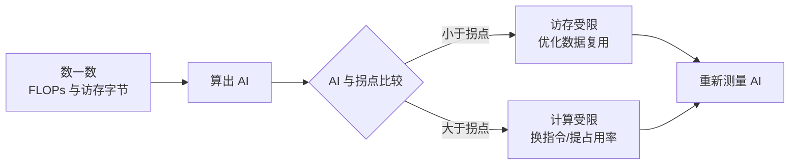

优化一个 kernel 之前，先回答一个问题：**它现在是被算力限制，还是被访存限制？** 答案不同，接下来该做的事完全相反。这篇笔记记两件事——各层存储差多少个数量级，以及怎么判断瓶颈。

## 存储层次的量级

同一次访问，落在不同层次上，代价差三个数量级：

| 层次 | 典型容量 | 延迟（约） | 带宽 |
|---|---|---|---|
| 寄存器 | 每线程 255 个 32 位 | 0（无延迟） | 最高 |
| 共享内存 / L1 | 每 SM 几十~几百 KB | 20~30 周期 | 很高 |
| L2 | 几十 MB | ~200 周期 | 高 |
| 显存（HBM） | 几十 GB | 400~800 周期 | 1~3 TB/s |
| 跨设备（PCIe/NVLink） | — | 微秒级 | GB/s |

这个表解释了优化的一条基本规律：**不要把"减少计算"当成第一目标，先想办法让每个字节被复用更多次。** 因为从一个字节里榨出更多计算，比少算几次要值钱得多。

## 局部性

复用有两种来源，分开看会清楚很多：

- **时间局部性**：刚访问过的数据，很快还会再访问 → 放进寄存器、共享内存缓存起来。
- **空间局部性**：访问了某个地址，邻近地址很快也会被访问 → 相邻线程访问相邻地址，让一次内存事务取回的数据全部有用。

GEMM 的分块优化本质上就是在用共享内存**手动制造时间局部性**：把一块数据搬进来，让块内所有线程反复使用。参见 [[programming/cuda-gemm]]。

## 算术强度与 Roofline

算术强度（Arithmetic Intensity, AI）定义为

$$
\text{AI} = \frac{\text{浮点运算次数}}{\text{访存字节数}} \quad \left[\frac{\text{FLOP}}{\text{Byte}}\right]
$$

Roofline 模型把硬件的两条上限画在同一张图上：

$$
\text{可达性能} = \min\left(\text{峰值算力},\ \text{带宽} \times \text{AI}\right)
$$

两条线交于**拐点** $\text{AI}^* = \dfrac{\text{峰值算力}}{\text{带宽}}$：

- $\text{AI} < \text{AI}^*$：落在斜坡上，是**访存受限**，提高 AI（继续复用数据）就能直接加速，换更强的算力没用。
- $\text{AI} > \text{AI}^*$：落在平台上，是**计算受限**，只能靠更快的指令（比如 Tensor Core）、更高的占用率或更少的无效计算。

以 A100 的 FP32 为例，$\text{AI}^* \approx 19.5\ \text{TFLOPS} / 1.55\ \text{TB/s} \approx 12.6$。前面算过 $4096^3$ 的 GEMM 理论 AI 约 682，所以它天生是计算受限的——这正是 GEMM 值得下功夫优化的原因。

## 用它看一个真实例子

一个逐元素的向量加法 `c = a + b`：读 2 个 float、写 1 个 float，做 1 次加法。

$$
\text{AI} = \frac{1}{12} \approx 0.083\ \text{FLOP/Byte}
$$

远在拐点左侧，纯访存受限，且 AI 固定不可提升——这类 kernel 唯一能做的就是减少总字节数（融合算子、用更窄的数据类型），再怎么调计算都没意义。

反过来，同一个算子如果和后面的激活函数融合，把中间结果留在寄存器里不落显存，就能省下 2 次（一读一写）访存，是实打实的加速。**算子融合的收益，本质上就是 Roofline 图上往右移动。**

## 实践顺序

1. 先算理论 AI，判断属于哪一类受限；
2. 用 profiling 工具量出实际访存字节，和理论下界比——差得远就说明复用没做好；
3. 访存受限 → 优化分块、提高复用、减少精度、融合算子；
4. 计算受限 → 换更快指令（Tensor Core、FMA）、提高占用率、消除分支与不必要的计算；
5. 改完重新量，别凭感觉。

> [!TIP]
> 一个很实用的检查：如果砍掉一半的计算量，耗时几乎不变，那它一定是访存受限的。

## 相关

- CUDA 算子优化：GEMM：[[programming/cuda-gemm]]
