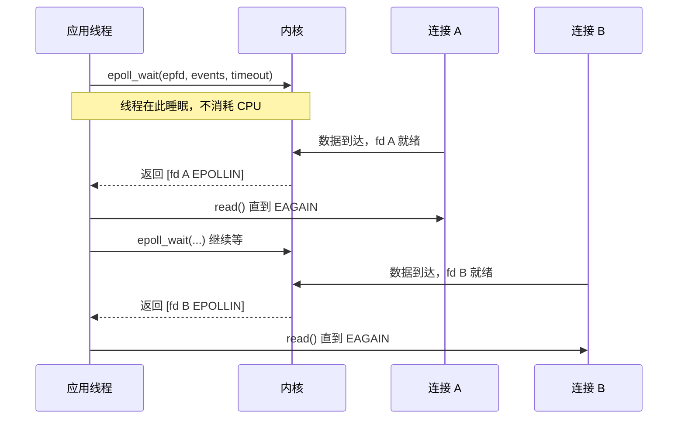

单线程要同时处理上万个连接，靠的不是多开线程，而是**让内核帮你盯着谁有数据了**。这篇笔记记 IO 多路复用的来龙去脉。

## 五种 IO 模型

| 模型 | 等待数据 | 拷贝数据 | 特点 |
|---|---|---|---|
| 阻塞 IO | 阻塞 | 阻塞 | 最简单，一连接一线程 |
| 非阻塞 IO | 轮询 | 阻塞 | 空转烧 CPU |
| IO 多路复用 | 阻塞在 `select`/`epoll` | 阻塞 | 一个线程管多连接 |
| 信号驱动 IO | 不阻塞 | 阻塞 | 用得少 |
| 异步 IO（AIO） | 不阻塞 | **不阻塞** | 真异步，Linux 上生态弱 |

严格说，前四种都是**同步 IO**：真正的数据拷贝阶段仍会阻塞。只有 AIO 是内核把数据拷完再通知你。

## 为什么需要多路复用

一连接一线程的模型在连接数上千后就开始吃亏：每个线程一份栈、一次上下文切换、一次调度。而大多数连接大部分时间都是**空闲的**，为它们常驻线程是纯浪费。

多路复用的思路是：把所有 fd 交给内核，让内核在"有事件就绪"时才唤醒我。进程大部分时间睡在一个系统调用里，被唤醒后只处理真正有数据的连接。



## select / poll / epoll 的差别

| 对比项 | select | poll | epoll |
|---|---|---|---|
| fd 上限 | 1024（`FD_SETSIZE`） | 无硬上限 | 无硬上限 |
| 每次调用 | 传整个 fd 集合，内核逐个轮询 | 同 select | 只在注册/删除时传，内核用红黑树维护 |
| 就绪通知 | 返回后自己遍历集合 | 同 select | 内核把就绪 fd 挂到就绪链表，直接返回 |
| 时间复杂度 | $O(n)$ | $O(n)$ | $O(1)$（与总连接数无关） |
| 触发模式 | LT | LT | LT 与 ET |
| 跨平台 | 全部平台 | 多数平台 | 仅 Linux |

$n$ 是**总连接数**而不是就绪数，这是 epoll 真正的优势所在：select/poll 每次调用都要把 $n$ 个 fd 检查一遍，连接越多越慢；epoll 的代价只和"就绪的连接数"有关。

## epoll 的三个调用

```c
int epfd = epoll_create1(0);                  // 建一个 epoll 实例

struct epoll_event ev;
ev.events = EPOLLIN;                          // 关心可读事件
ev.data.fd = listen_fd;
epoll_ctl(epfd, EPOLL_CTL_ADD, listen_fd, &ev);  // 注册，只做一次

struct epoll_event events[MAX_EVENTS];
int n = epoll_wait(epfd, events, MAX_EVENTS, -1); // -1 表示永久阻塞
for (int i = 0; i < n; ++i) {
    int fd = events[i].data.fd;
    // 处理这个 fd
}
```

三个调用各司其职：`epoll_create1` 建实例，`epoll_ctl` 增删改（只调用一次，不是每轮都调），`epoll_wait` 取就绪列表。**注册与等待的分离**正是它比 select 高效的原因。

## LT 与 ET

| 模式 | 行为 | 适合 |
|---|---|---|
| 水平触发 LT（默认） | 只要缓冲区还有数据，每次 `epoll_wait` 都会通知 | 大多数场景，写起来不容易漏 |
| 边缘触发 ET（`EPOLLET`） | 只在状态**变化**时通知一次 | 追求极致性能，必须配合非阻塞 fd |

ET 模式有一条硬性要求：

```c
// ET 模式下必须循环读到 EAGAIN，否则剩余数据要等下次状态变化才通知
while (1) {
    ssize_t n = read(fd, buf, sizeof(buf));
    if (n > 0) { /* 处理数据 */ }
    else if (n == 0) { /* 对端关闭 */ break; }
    else {
        if (errno == EAGAIN || errno == EWOULDBLOCK) break;  // 读干净了
        if (errno == EINTR) continue;                        // 被信号打断，重试
        /* 真正的错误 */ break;
    }
}
```

> [!IMPORTANT]
> ET 必须搭配非阻塞 fd。阻塞 fd 上循环读会在最后一次 `read` 时把线程挂住，整个事件循环停摆——这是 ET 模式最经典的翻车方式。

## 实践中的几个坑

- **惊群**：多个进程/线程阻塞在同一个 `epoll_wait` 上，事件到达时全被唤醒但只有一个能处理。Linux 4.5+ 的 `EPOLLEXCLUSIVE`，或用 `SO_REUSEPORT` 让每个 worker 各有独立监听队列。
- **`EINTR` 必须处理**：被信号中断的系统调用要重试，否则会遇到"随机丢事件"。
- **缓冲区只读一半**：LT 下会再通知一次（能自愈），ET 下就永久丢数据。
- **就绪列表是快照**：`epoll_wait` 返回的数组里，某个 fd 的事件可能已被其他线程在 `EPOLL_CTL_DEL` 后失效，多线程处理同一 epfd 时要小心。
- **`EPOLLOUT` 不要常驻注册**：可写是常态，一直监听会让 `epoll_wait` 疯狂空转。发送缓冲区满时才注册，写完立刻摘掉。

## 该用哪个

- 连接数少（几十个）且逻辑简单：阻塞 IO + 一线程一连接，最省心；
- 连接数多、并发高、Linux 部署：epoll，且优先用 LT 模式，把 ET 留给压测证明有收益的场景；
- 需要跨平台（含 macOS/BSD）：poll 或 kqueue 封装（libevent/libuv 已经做完了这件事）；
- 不想自己管事件循环：直接上框架，把精力留给业务。

## 相关

- 存储层次那篇里"先判断瓶颈"的方法同样适用：并发模型的选择也该先量后调：[[programming/memory-hierarchy]]
